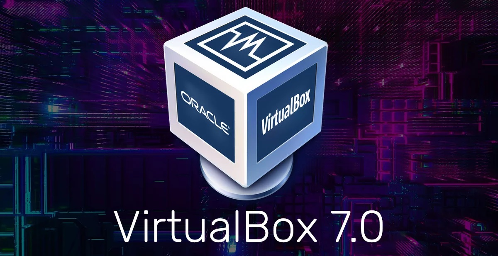
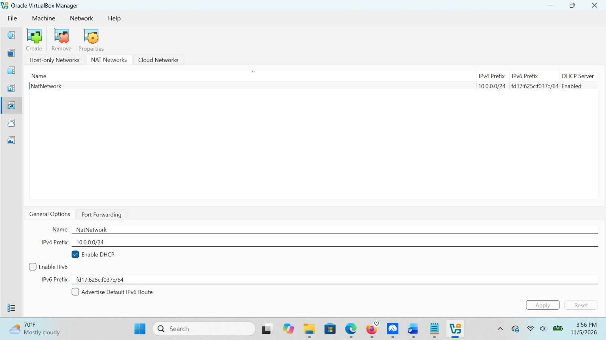
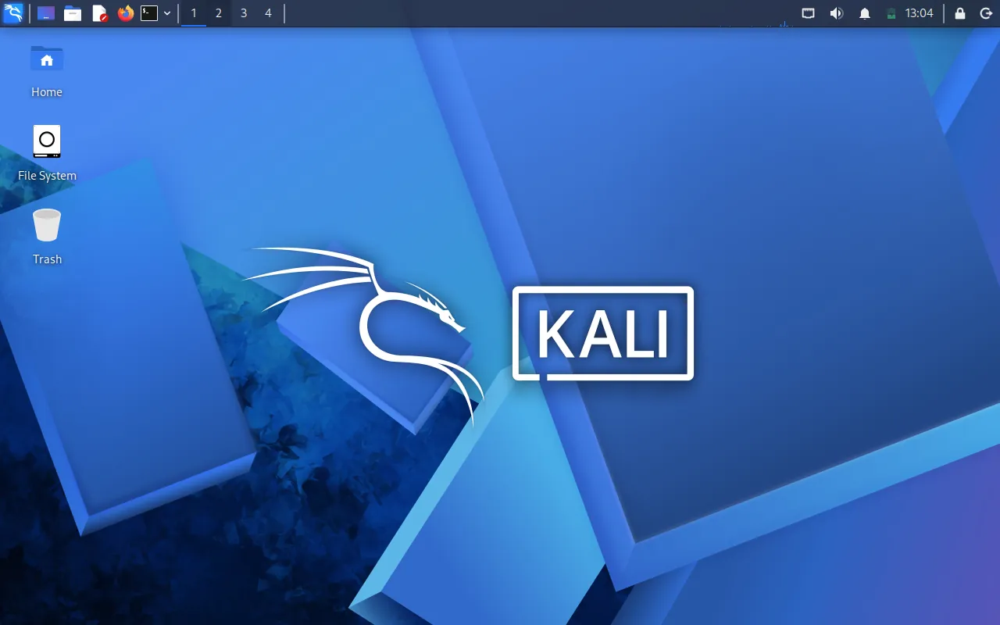
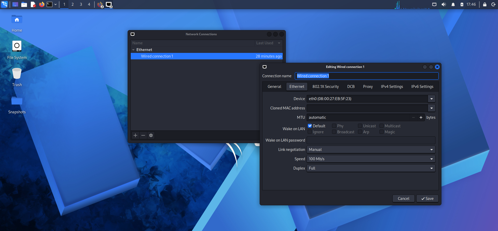

<div align="center">

# 🔐 Cybersecurity Internship – B084 | Week 1: Lab Setup

**Building an isolated virtual lab for penetration testing and ethical hacking practice**

</div>

<p align="center">
  
  
  
  
  
  
  
  
  
  
  
  
</p>

---

## 📌 Project Overview

As part of my Cybersecurity Internship with NetworkWalks (Batch B084), I worked on setting up a virtual cybersecurity lab using Oracle VirtualBox and Kali Linux.

The main purpose of this project was to create a safe and practical environment where I could develop my cybersecurity skills through hands-on learning and testing. With this lab, I can practice network scanning, information gathering, vulnerability assessment, and other cybersecurity activities without putting real systems or networks at risk.

I configured the lab using a private NAT Network, which allows me to connect additional virtual machines in the future. This setup will help me carry out authorized penetration testing, explore different security tools, and improve my understanding of how cybersecurity professionals identify and address security vulnerabilities.

---

## 🎯 Project Objectives

The main objectives of my Week 1 lab setup were to:

- Install and configure Oracle VirtualBox on my computer.
- Download and set up Kali Linux as a virtual machine.
- Create a private NAT Network for my cybersecurity lab.
- Configure the network settings for Kali Linux.
- Assign a consistent IP address to my Kali Linux virtual machine.
- Test network connectivity between the virtual machine and the network.
- Verify internet connectivity and DNS resolution.
- Create a clean snapshot of my Kali Linux VM for backup and recovery.
- Document the steps involved in setting up the lab.
- Prepare my virtual environment for future cybersecurity exercises and projects.

---

## 🛡️ Purpose of My Cybersecurity Lab

I built this lab to gain practical experience in cybersecurity and understand how security testing is performed in a controlled environment.

The lab gives me the opportunity to practice different cybersecurity techniques, become familiar with industry tools, and strengthen my technical skills through real-world simulations.

Some of the activities I plan to carry out in this lab include:

- **Network Reconnaissance:** Learning how to identify devices, systems, and services within a network.
- **Port Scanning:** Using security tools to discover open ports and running services.
- **Vulnerability Assessment:** Identifying potential security weaknesses in authorized systems.
- **Packet Analysis:** Examining network traffic to understand communication between devices.
- **Web Application Security Testing:** Learning how to identify common vulnerabilities in web applications.
- **Ethical Hacking Practice:** Performing authorized penetration-testing exercises in a safe environment.
- **Security Tool Experimentation:** Practicing with Kali Linux tools to improve my cybersecurity knowledge and technical abilities.

### ⚠️ Ethical and Responsible Use

This cybersecurity lab is strictly for educational purposes, hands-on learning, and authorized security testing.

I will only perform security assessments on systems and networks that I own or have been given permission to test. My goal is to develop responsible cybersecurity practices while improving my ability to identify, analyze, and address security risks.

---

## 🏗️ Lab Architecture


Additional target machines can be added to the same virtual network in future projects.

---

## ⚙️ Lab Configuration

| 🧩 Component       | ⚙️ Configuration   |
| ------------------ | ------------------ |
| 🖥️ Host OS         | Windows 10         |
| 🧠 Host RAM        | 8 GB               |
| ⚡ Processor       | Intel Core i7      |
| 🧰 Hypervisor      | VirtualBox 7.2     |
| 🐉 Security OS     | Kali Linux 2026.2  |
| 🧠 Kali RAM        | 2048 MB            |
| 🌐 Virtual Network | NAT Network        |
| 📡 Network Address | 10.0.0.0/24        |
| 🐧 Kali IP Address | 10.0.0.2/24        |
| 🚪 Default Gateway | 10.0.0.1           |
| 🌍 DNS Server      | 8.8.8.8            |
| 🔮 Future VM Range | 10.0.0.3–10.0.0.99 |

---

---

# 🪜 Lab Setup Procedure

## Step 1. Install 7-Zip

I started by installing **7-Zip**, a file extraction tool that allows me to extract compressed files, including the `.7z` format used for Kali Linux virtual machine packages.

This was necessary to prepare the downloaded Kali Linux files before importing them into Oracle VirtualBox.

**Tool Used:** 7-Zip

---

## Step 2. Install Oracle VirtualBox

Next, I installed **Oracle VirtualBox 7.2** on my Windows computer.

VirtualBox serves as the hypervisor for my cybersecurity lab, allowing me to create, configure, and manage virtual machines within a controlled environment.

With VirtualBox, I can run Kali Linux alongside my host operating system without needing a separate physical computer.

**Tool Used:** Oracle VirtualBox 7.2

---

## Step 3. Create the NAT Network

After installing VirtualBox, I created a dedicated **NAT Network** to provide network connectivity for my cybersecurity lab.

I configured the network using the following settings:

**Network Configuration:**

- **Network Name:** NatNetwork
- **IPv4 Prefix:** 10.0.0.0/24
- **DHCP:** Enabled
- **IPv6:** Disabled
  
** Virtualbox NAT Manager Screenhoot


I selected the NAT Network option because it allows multiple virtual machines connected to the same network to communicate with one another while also providing outbound internet connectivity.

This configuration will allow me to add additional virtual machines in future projects, including attacker and target machines, so I can practice network scanning, vulnerability assessment, and authorized penetration testing in a controlled lab environment.

---


This setup will allow me to connect additional virtual machines to my lab network in future projects. These machines can serve as attacker or target systems for practicing authorized penetration testing and other cybersecurity exercises.

---

## Step 4. Import Kali Linux

After configuring my virtual network, I downloaded the Kali Linux virtual machine from the official Kali Linux website and imported it into Oracle VirtualBox.

I then configured the virtual machine's network adapter to connect to the NAT Network I had created earlier.

**Network Adapter Configuration:**

```text
Adapter 1
Attached to: NAT Network
Network:     NatNetwork
Adapter Type: Intel PRO/1000 MT Desktop
```

I also allocated the following memory to my Kali Linux virtual machine:

```text
RAM: 2048 MB
```



To make file transfers easier, I configured a shared folder between my Windows host computer and the Kali Linux virtual machine.

This allows me to transfer files needed for my cybersecurity exercises between both operating systems.

---

## Step 5. Configure the Kali Linux Network

Once Kali Linux was running, I checked its network settings and configured a consistent IPv4 address.

This was important because I wanted my Kali Linux machine to maintain a predictable IP address that I could easily identify when performing network scanning and other cybersecurity activities.

**My Network Configuration:**

```text
IP Address: 10.0.0.2
Subnet Mask: 255.255.255.0
Gateway:     10.0.0.1
DNS Server:  8.8.8.8
```

Using a consistent IP address will make it easier for me to identify my Kali Linux machine, document network activities, and connect additional virtual machines during future lab exercises.



---

## Step 6. Create a Clean VM Snapshot

After completing the initial Kali Linux installation and network configuration, I created a snapshot in VirtualBox.

**Snapshot Name:**

```text
Clean Kali - Network Setup
```

I created this snapshot to preserve the original working configuration of my virtual machine.

If I encounter configuration errors or make changes that affect the system during future cybersecurity exercises, I can restore the virtual machine to this clean state instead of reinstalling everything.

This is an important practice because it helps me save time and maintain a reliable testing environment.

---

# 🔎 Lab Verification

After setting up my cybersecurity lab, I used several Linux commands to check the network configuration and verify that the necessary tools were available.

The following table shows the verification commands and the expected results.

| ✅ Test | 🧾 Command | 🎯 Expected Result |
| ----------------------------- | ------------------------------- | ------------------------------- |
| 🌐 Check IP address | `ip a` | Kali Linux IP address displayed |
| 📡 Test default gateway | `ping 10.0.0.1` | Successful replies |
| 🌍 Test Internet connectivity | `ping 8.8.8.8` | Successful replies |
| 🔎 Test DNS resolution | `nslookup networkwalks.com` | Domain resolves successfully |
| 🧰 Verify Nmap installation | `nmap --version` | Installed Nmap version displayed |
| 🔄 Verify VM snapshot | Restore snapshot and run `ip a` | Baseline configuration restored |

### Example Network Configuration

```text
IP Address:
10.0.0.2/24

Default Gateway:
10.0.0.1

DNS Server:
8.8.8.8
```

These checks help me confirm whether my virtual machine is properly configured and ready for future cybersecurity activities.

---

# 🐞 Problems Encountered & Solutions

During the lab setup process, I learned that virtualization and network configuration can sometimes present technical challenges.

Understanding how to identify and resolve these issues is an important part of developing my cybersecurity troubleshooting skills.

## Problem 1. Internet Connectivity After Static IP Configuration

One of the network configuration issues I examined involved Internet connectivity after manually assigning an IPv4 address to Kali Linux.

Depending on the NetworkManager settings, manually configuring an IP address may affect network communication.

One troubleshooting command used in this lab was:

```bash
sudo nmcli connection modify "Wired connection 1" ipv4.dad-timeout 0
```

This command changes the IPv4 duplicate-address detection timeout setting for the specified NetworkManager connection.

After applying the configuration, I could restart the network connection and test connectivity again using commands such as:

```bash
ip a
ping 10.0.0.1
ping 8.8.8.8
```

**Important:** Network connection names may differ between systems. Before using the command, I can identify the correct connection name with:

```bash
nmcli connection show
```

I also learned that troubleshooting network problems requires checking the IP address, gateway, DNS configuration, and connection status rather than assuming one setting is responsible.

---

## Problem 2. VirtualBox VT-x / Virtualization Error

Another issue covered during the setup involved VirtualBox failing to start a virtual machine when hardware virtualization was disabled.

To resolve this issue, the following steps can be followed:

1. Restart the Windows computer.
2. Enter the BIOS/UEFI settings.
3. Locate the hardware virtualization option.
4. Enable Intel VT-x or the applicable virtualization feature.
5. Save the BIOS/UEFI configuration.
6. Restart the computer.
7. Open VirtualBox and start the Kali Linux virtual machine again.

Enabling hardware virtualization allows VirtualBox to use the processor's virtualization capabilities.

This helped me understand the relationship between physical computer hardware and virtual machine performance.

---

# 💡 What I Learned

Completing my Week 1 cybersecurity lab setup helped me understand how virtual machines, operating systems, and networking work together to create a practical cybersecurity testing environment.

The project also strengthened my knowledge of system configuration, troubleshooting, and technical documentation.

### 1. Understanding NAT vs NAT Network

I learned that standard NAT and NAT Network are different networking options in VirtualBox.

With standard NAT, a virtual machine can access external networks, but separate virtual machines do not automatically share the same private network.

A NAT Network allows multiple virtual machines connected to the same virtual network to communicate with one another while providing outbound connectivity.

This makes NAT Network a useful option for my cybersecurity lab because I plan to add more virtual machines for future security testing exercises.

### 2. Virtual Machine Networking

I gained a better understanding of how VirtualBox network adapters work and how different networking configurations affect communication between virtual machines.

I also learned how network settings determine whether virtual machines can communicate with one another or access external networks.

### 3. Static IP Address Configuration

This project helped me improve my understanding of IPv4 addressing and network configuration in Kali Linux.

I practiced working with:

- IP addresses
- Subnet masks
- Default gateways
- DNS servers
- Network interfaces
- Network connectivity commands

These are important networking concepts that I will continue using throughout my cybersecurity training.

### 4. Importance of Virtual Machine Snapshots

I learned why creating a snapshot is important before performing security experiments or making major configuration changes.

A snapshot provides a recovery point that allows me to return my virtual machine to an earlier working state.

This will be useful when practicing penetration testing, installing new tools, or experimenting with different system configurations.

### 5. Technical Documentation

One of the most valuable lessons from this project was understanding the importance of documenting my work.

By recording my configuration settings, commands, screenshots, troubleshooting steps, and results, I can easily review what I have done and repeat the process when necessary.

Good documentation also helps me demonstrate my technical skills and communicate my work professionally.

---

# 🔐 Security & Ethical Use

I created this cybersecurity lab strictly for educational purposes, practical learning, and authorized security testing.

My goal is to develop the knowledge and technical skills needed to identify vulnerabilities, understand cybersecurity threats, and improve system security.

I will only perform penetration testing and other security assessments on systems that I own or have been given explicit permission to test.

I understand that ethical hacking requires responsibility, professionalism, and respect for privacy and applicable laws.

---

# 🔗 Tools & Resources

The following tools and resources were used or referenced during my cybersecurity lab setup:

- **7-Zip:** [https://7-zip.org/download.html](https://7-zip.org/download.html)
- **Oracle VirtualBox:** [https://www.virtualbox.org/wiki/Downloads](https://www.virtualbox.org/wiki/Downloads)
- **Kali Linux:** [https://www.kali.org/get-kali/](https://www.kali.org/get-kali/)

---

# 👤 Author

**Lamidi Olatunji Micheal Eleshin**

**Cybersecurity Intern | NetworkWalks – Batch B084**

**Areas of Interest:** Cybersecurity | Ethical Hacking | Penetration Testing | Network Security | IT Risk Management

**GitHub:** [https://github.com/leleshin](https://github.com/leleshin)

---

## 📌 Project Information

**Program Name:** Cybersecurity Internship at NetworkWalks

**Batch:** B084

**Week:** 01

**Project:** Cybersecurity & Penetration Testing Lab Setup and Configuration

**Virtualization Platform:** Oracle VirtualBox

**Security Operating System:** Kali Linux

**Repository:** GitHub

---

